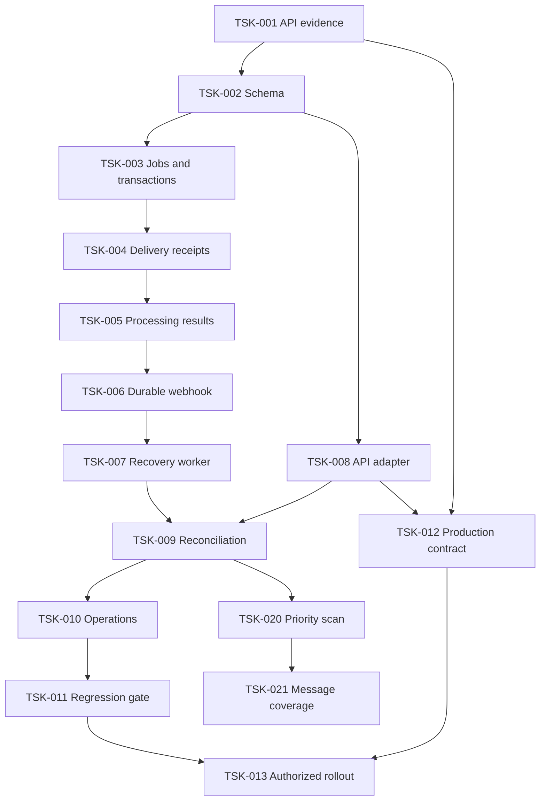

# Восстановление входящих: Tasks

## Micro 2026-11-04: окно тишины

- [x] TSK-033 Заменить fixed5с на5с после последнего нового сообщения в
  legacy/recovery; доказать продление, сохранение границ после простоя,
  MID-retry, restart, manager и незатронутый slowAI. Дедуп текста не добавлять.
  После кода профильный/полныйpytest, Ruff/diff, read-only review.
  Факт:3исходныхRED; профиль143PASS, полный1815PASS/8прежнихwarnings/98.73с.
  Ruff/diff PASS, независимое readonlyreview без блокеров. Проверены цепочка
  0/4/8→13, gapпослепозднегоtick, MIDretry, restart, независимые клиенты,
  post+2одинаковыхтекста→1job, ownercleanup, manager и прежнийslowAI.
  ADR0021 scan/add/review5/6/approve accepted:
  см. .kiro/decisions/0021-inbound-quiet-window.md. Сервер не менялся.

| Progress TSK-033 | Status |
| --- | --- |
| Debounce | Выложено04Nov01:09Минск, только2runtime-файла |

- [x] TSK-034 Разрешённый04Nov деплой только quiet-window от свежего
  serverbaseline: backup, штатный restart, config/data/health/logs postflight.
  Факт: packagec9799ee62db464aa07ee8b5be811b647f8f76ea20eb707be88730a3432ba3da9;
  candidate143PASS, rollout/inverseproof PASS, readonlyreview без блокеров.
  N42DeepSeek fix не включён. Только main.py/db/inbound.py иmanifest36.
  Prepare/apply/verify/postflight exit0. PID8248→18728,
  start03Nov22:09:03.2978786Z=04Nov01:09:03Минск. Postflight01:16Минск:
  public200/localhealthok, integrityok,36SHA PASS, errors/warnings/tracebacks0,
  unassigned/sending/unknown0. Сохранены1550receipts,27terminal и1837sessions:
  1836digestпрежние,1изменён новыми входящими (подтверждено). Scopeall/env/
  credentials/baselines/8туров прежние; SQLite не восстанавливалась.
  Installed AST+memoryproof0/4/8→13 PASS, без модели/ручных отправок.
  urllibполучалCloudflare403/1010; обычныйHTTPX200 с клиента и сервера,
  правила защиты не менялись. Артефакт quiet-release-20261104.

## Общий scope — 2026-11-02

- [x] TSK-032 После нового разрешения владельца подготовить и проверить
  config-only scopeall rollout, backup/flags-off/inverse; включить и проверить
  новые baseline/scope/health/runtime/data/очереди/логи. Старую переписку не
  переигрывать, baseline тестера/паузы/лимиты/receipts сохранить.
  Факт:02Nov23:50Минск config-onlyscopeall; runtime0файлов,36SHA прежние.
  Packagebb02f665ba7bf12804544f1c38f8d3d81436e08d7650d87377ff7ac0c8c244ee;
  backup/proof/review/55profilePASS. Prepare/apply/verify/postflight exit0.
  PID13652→8248,start20:50:21.3409076Z; global baseline20:50:29.795800Z
  (23:50:29Минск), tester baseline прежний. Сохранены1311receipts,8terminal
  jobs, все1761старыхstate. Flags-offfallback подготовлен, SQLite не откатывалась.
  В23:53Минск34диалога проверены, scanfailures0, очереди/unknown0,
  oldforeignreplays0, fresherrors/warnings0. Первая новая заявка НЕтестера:
  done/answered,1modelattempt,1Instagramsent/attempt1/part0/receiptесть;
  событие послеglobalcutoff, источникwebhook. Полныйобщийпроходещёнезавершён,
  известныйincomplete_identitygap1сохраняется. НеполныеAPIмедиаограничения прежние.

## Свежий контроль после выкладки дат — 2026-11-02

- [x] TSK-031 Новый вопрос тестера о Белостоке, task/reply/receipt и повторная
  сверка Meta без дублей; паузу/историю/лимиты не менять.
  Факт:02Nov23:30:58Минск создан job51fb4665cbde48d19d4cd54e49042e16,
  members1, done/answered, model_attempts1; один Instagram sent/part0/attempt1,
  receipt есть. Ответ содержит программу и booking Белостока. В23:33:03Минск
  источники того же MID — api+webhook, version1; задача/вызов/доставка прежние,
  очередь0, managerpausefalse, scopeallowlist/1. Нового технического сбоя не
  вводили: это проверка обычного live маршрута и дедупликации после сверки;
  сбои/перезапуск/частичная доставка ранее проверены стендом.
  Evidence: live-recovery-check-20261102-result.json в bundle tour-dates-release.

## Identity audit2026-11-01

- [x] TSK-028 Validate participant shape/IDs and deduplicate; fail closed before
  scope filtering; offline recovery failure tests and independent read-only review.
  Факт:11RED ->125profilePASS, final1748PASS/8existing warnings/96.10s,
  Ruff/diff/review PASS. Meta direct+expanded participants100bothreturnonlyown
  account, no nextpage, nottestercheckpoint; identitygapremainsunresolved.
  Live2messages1.25s ->1job/1modelattempt/1sentreceipt; laterAPI+webhook both
  observed atversion1, no duplicate, queue0. Earlierpair5.34s correctly2jobs.
  На этапе локальной проверки production не менялся; выкладка — см. TSK-030.
- [x] TSK-029 Проверить свежие фото, прямое видео и голосовое на тестере.
  Факт: 01.11.2026, 13:35 Минск — три задачи done/answered, по одному
  вызову модели и одному подтверждённому ответу Instagram. Повторная сверка
  объединила API/webhook по тем же MID, версия событий осталась 1; очередь 0,
  возраст checkpoint 43 с. В прямом запросе Meta фото вернулось с image_data.url,
  видео — с video_data.url. Голосовое: is_unsupported=true, attachments/shares
  пусты; его содержимое сохранил webhook. API-only восстановление такого
  голосового не подтверждено и недоступно по полученному ответу Meta.
  Evidence: recovery-media-api-proof-20261101-result.json (read-only SSH audit).
- [x] TSK-030 Выложить только проверку участников после «+» владельца 01.11.2026.
  Подготовить пакет одного source-файла и manifest, backup и проверенный inverse;
  сверить SHA с сервером, штатно перезапустить и проверить health/scope/очереди.
  Не менять .env, временные границы, историю, лимиты и sent/unknown receipts.
  Факт: 01.11.2026, 13:56 Минск — установлен один source и manifest (36 SHA),
  PID 12328 → 17976, start 10:56:15.3078558Z. Package SHA:
  190e0f940f05d3f2cff15a6ac62566c5426aafae1f93ad1740d9b1bed99f1840.
  Prepare/apply/verify/postflight exit 0; backup, inverse proof и review PASS.
  В 13:57 Минск local/public health ok, свежих errors/warnings/tracebacks 0,
  очереди/unknown/sending 0, tester checkpoint обновился после restart.
  Сохранены 1143 прежних receipts, все 1712 состояний сессий и 8 terminal jobs;
  .env/credentials/baselines неизменны, recovery allowlist/1, каталог 8 туров.

| Progress identity audit | Status |
| --- | --- |
| Local | Identity validation fixed;1748PASS/Ruff/diff/review PASS; пакет проверен |
| Production | Fix выложен 01.11.2026 в 13:56 Минск; tester only; health/очереди/состояние проверены |
| Live media | 3 подтверждённых ответа без дублей; API возвращает фото/видео, но не это голосовое |

## TSK-027. Story reaction с webhook milliseconds — 2026-10-20

Уточнение владельца до выкладки: TTL600с в обоих маршрутах, разрешён деплой.
- [x] Проверить119/120/121/599/600/601с, дубликаты и one-shot; полный pytest/Ruff.
- [x] Собрать новый пакет10мин и доказать rollback; прежний2мин не применять.
- [x] Выложить3 source+manifest31, restart/verify; сохранить allowlist/1,
  baseline/session/limits/receipts и проверить очереди/логи.
  Факт:20 focused PASS; полный1533 PASS/8 прежних warnings/68.87с;
  Ruff/diff/review/rollback proof PASS. Prepare/apply/verify exit0;
  PID12736→5380, start12:08:23Z,31 SHA/health/TTL600 PASS. Все292 прежних
  sent receipts, terminal jobs и tester session/revision сохранены, queues0.

Requirement: S7.1..4 media-understanding, recovery route parity; bugfix.md.

- [x] Воспроизвести реальный parser(ms) → persist/restart → question/merge,
  проверить секунды/API, прежний TTL120с, одноразовое потребление и логи.
- [x] Нормализовать before на границе story_hint; добавить безопасную
  диагностику received/attached без ответа на саму реакцию.
- [x] Профильный/полный pytest, Ruff/diff/review; обновить runtime evidence.
  Первоначально локальная проверка; затем владелец разрешил10мин и деплой.
  Старые задачи не переигрывать, scope не менять.
  Факт:10 FAIL/3 PASS до исправления →13 PASS после. Профиль431 PASS/25.80с,
  полный1525 PASS/8 прежних warnings/68.84с; Ruff/diff/read-only review PASS.
  Source diff53 строки в3 файлах, local guarded package/rollback proof PASS;
  inverse/partial failure сохраняют новые receipts/unknown, неожиданные
  изменения блокируются. См. runtime/recovery-story-reaction-context.md.

| Progress TSK-027 | Сейчас | Дальше |
| --- | --- | --- |
| Story context | Выложен20Oct15:08 Минск;TTL600 в обоих маршрутах,1533 PASS,31 SHA/health | Новая живая реакция+вопрос; старые задачи не переигрывать |

## TSK-026. Раннее срабатывание таймера Windows — 2026-10-20

Requirement: существующие FR-12/13, AC-27..30; bugfix.md и решение0012.

- [x] Добавить детерминированную регрессию раннего собственного таймера,
  отдельно сохранив ранний внутренний timeout и внешнюю отмену.
- [x] Исправить только различение собственного deadline в scanner и owned refresh.
- [x] Проверить cursor/отмену await; профильный и полный pytest, Ruff/diff/review.
  Обновить evidence и runtime note. Сервер и scope не менять.
  Факт: до фикса3 FAIL/6 PASS; после9 PASS, профиль108 PASS/29.76с,
  полный1512 PASS/8 прежних warnings/69.83с, Ruff/diff/review PASS.
  На серверном Python3.12.10 candidate выполнялся только в памяти отдельного
  процесса:30 scanner+30 refresh, ложных ошибок/backoff0, отмена await60/60,
  cursor сохранён60/60. API/БД не вызывались, рабочие файлы не заменялись.
  См. runtime/recovery-windows-deadline.md; существующее решение0012.
- [x] Отдельно разрешённая20Oct выкладка: один source и manifest31,
  prepare/apply/verify PASS; PID12960→12736, start11:32:34Z.
  Факт: два новых checkpoint через120.852с, gap=false/scan_failures0;
  прежние280 sent receipts, terminal jobs и полная tester session/revision
  сохранены. Protected hashes/baseline прежние, queues0, ошибок в окне нет.

| Progress TSK-026 | Сейчас | Дальше |
| --- | --- | --- |
| Deadline | Выложен20Oct14:32 Минск;31 SHA/health PASS; два checkpoint120.852с без gap/errors | Наблюдать штатные обращения; scope allowlist/1 прежний |

## TSK-025. Разрешённое включение для всех — 2026-10-18

Пользователь отдельно запросил «деплой» после рисков scope=all.
- [x] Read-only preflight: 29 SHA, отсутствие global baseline/старой очереди,
  client baseline, protected launchers; независимое review без блокеров.
- [x] Подготовить config-only пакет/backup/controller и доказать откат без
  восстановления БД, сохранив receipts/unknown в изолированной копии.
- [ ] Заменить только scope, штатный restart; проверить новый PID/health/admin,
  все runtime SHA, новую global и прежнюю тестовую baseline, старые receipts.
- [ ] Проверить два тика scanner, backlog/errors/unknown; записать evidence.

Источник: rollout.md; существующие FR-7..9 и approved scope/baseline design.
Runtime и интервалы не меняются; расширение API-only media ограничений не обещается.

| Progress TSK-025 | Сейчас | Дальше |
| --- | --- | --- |
| All | Backup/proof/review/46 tests PASS; apply не выполнен. Владелец ответил «пока не» | Включение отложено; сохранять allowlist, ждать нового явного согласия |

Факт: remote phase prepared, admin allowlist, прежний .env подтверждён после
отказа. Причина отказа: «деплой» не принято как явное согласие scope=all.
Вопрос пользователю поставлен; никаких обходных попыток apply не выполнялось.

## Дополнительная приёмка отказов — TSK-024

- [x] Частичный IG-ответ через настоящий pipeline; restart и повтор доставки
  только неотправленного фрагмента, без повторного ainvoke/assistant history.
- [x] Unknown timeout и отсутствие receipt: restart, API/webhook дедупликация
  и worker не отправляют ответ повторно; сохранённый результат не регенерируется.
- [x] Настоящий manager-event во время await модели отменяет задачу и обе
  внешние доставки; снятие паузы и restart её не возрождают.
- [x] Профильный/полный pytest, Ruff/diff, read-only review и evidence.
  Факт: 4 новых cases, весь acceptance-файл6 PASS/17.14 с; полный pytest1486
  PASS/8 прежних warnings/75.83 с; после review усилено сравнение полной
  manager-сессии/revision/result, отдельный прогон1 PASS/8.04 с. Ruff/diff PASS,
  блокирующих review-замечаний нет. См. runtime/recovery-acceptance-proof.md.

Requirement: FR-2/4/5, прежние AC partial/unknown/manager. Источник: «давай еще
тестов». Runtime/production не менять; внешние HTTP и платные вызовы в стенде
запрещены. Живые сообщения отправляет пользователь в тестовый диалог.

| Progress TSK-024 | Сейчас | Дальше |
| --- | --- | --- |
| Отказы | 4 новых случая PASS; полный pytest1486 PASS, Ruff/diff/review PASS | Runtime не менялся; живые2 MID → одна задача/один ответ, API-дублей нет |

Живой факт: два новых MID18:21:47/49 UTC (интервал2.394 с) объединены,
members2, обе части вопроса в payload. Один valid toolcall/один sent IG receipt,
точные ID/текст/адресат совпали с Meta. В18:23:57 UTC после штатного scanner
оба sources api+webhook; задач/модельных вызовов/доставок по-прежнему по одному.
gap=false, technical/semantic0, pause=false. Только read-only диагностика;
общий scope не включался. Evidence: runtime/recovery-acceptance-proof.md.

## Приёмочная проверка 2026-10-18 — до новых тестов

Пользователь одобрил продолжение проверки первого пункта плана («+»).
Runtime и production-конфигурацию не менять; платных вызовов и отправок нет.
Использовать существующую архитектуру и настоящий основной обработчик,
временную SQLite, заглушки Graph/DeepSeek/Instagram/Telegram.

- [x] **TSK-023. Сквозной пропуск webhook и перезапуск**
  - Requirement: FR-1..5, FR-8; существующие AC восстановления и дедупликации.
  - Deliverables: новое сообщение только из scanner; пересоздание store/service
    до обработки; настоящий dispatch и refresh без заглушки refresh_client.
    Подтверждённый receipt; повторный startup/API и поздний webhook того же MID.
  - Acceptance: одна задача, один модельный вызов, одна отправка и пара записей
    истории; повторная обработка не создаёт дублей. Отдельно проверить restart
    после прерванного claim: lease и задержка 120 с соблюдаются.
  - Verification: профильный pytest, Ruff/diff; факты production только read-only.
    Сверить прежние live receipts и обновить устаревшие пункты gate. Живая новая
    проверка при снятии паузы, расширение scope и деплой требуют своего согласия.
  - Факт: 200 исходных профильных PASS, 2 новых сквозных PASS и усиленные
    assertions после read-only review PASS; полный pytest1482 PASS/8 прежних
    warnings/67.87 с, Ruff/diff PASS. Четыре IG receipts сопоставлены с Meta;
    TG receipts по четырём уникальным назначениям без повторов. См.
    `runtime/recovery-acceptance-proof.md`. Runtime/production не менялись.

| Progress TSK-023 | Сейчас | Дальше |
| --- | --- | --- |
| Проверка | Стенд/receipts и новый live happy-path PASS; 1482 теста PASS | Общий enable отдельно; API-only media ограничения сохраняются |

## TSK-022. Пауза менеджера перед восстановлением

- [x] Воспроизвести pause/pending до и во время refresh, последний retry и
  StaleWork: 9 RED/4 исходных PASS после настройки изолированного recovery scope.
- [x] Минимальный guard state/claim/pause до/после refresh и в StaleWork;
  13 GREEN, ещё 5 проверок нового владельца/конечных состояний GREEN.
- [x] Полный pytest/Ruff/diff, read-only review, runtime evidence.
  Факт: профильный process/pipeline прогон 83 PASS; 18 pause regressions PASS.
  Полный pytest 1480 PASS/8 прежних warnings, 55.41 с; Ruff/diff PASS.
  Независимое review без блокеров. Requirement: FR-17, AC-37..39; см. bugfix.md
  и runtime/recovery-manager-pause-priority.md.
  Архитектура из прежней спеки сохраняется. После отдельного «деплой»
  установлен совместный пакет4, PID4136/29 SHA/health PASS; настройки сохранены.

| Progress TSK-022 | Сейчас | Дальше |
| --- | --- | --- |
| Пауза | Выложено: 18 новых проверок, 1480 PASS; PID4136/29 SHA/health | Новые реальные события; старые failed_final не переигрываются |

Статус: Tasks утверждены явным запросом реализации 2026-10-16.
Design утверждён пользователем 2026-10-15
с правкой времён выбранной строки ×4. Локальная реализация завершена.
2026-10-16 пользователь отдельно разрешил текущий деплой «для теста»:
только @_shelter_0, без приёмника, с известными API-only ограничениями.

Источник: `requirements.md`, `design.md`.
Архитектура: `.kiro/decisions/0001-inbound-recovery-hybrid.md`.

## Параметры, которые нельзя смешивать

| Таймер | Значение |
| --- | --- |
| Проверка зависшей/оборвавшейся обработки | 60 с |
| Технические повторы после ошибок | Не более двух, задержки 120 и 480 с |
| Conversations API | После запуска и каждые 120 с; полный проход может занимать несколько тиков |
| Семантический пересмотр молчаливой передачи | Один раз через 120 с |
| Группировка входящих | Прежние 5 с |
| Lease / heartbeat | 180 / 15 с |
| API: timeout / deadline тика | 15 / 90 с |
| API: backoff | 30 / 120 / 300 с; при rate limit учесть Retry-After |
| API: общий pacing / concurrency | Не чаще 1 GET/с без burst; не выше 2 |

Время due — нижняя граница следующей попытки, не обещание запуска с точностью
до секунды: watchdog, блокировка клиента и backoff могут отложить её.
Первый успешный LLM-ответ не регенерируется из-за ошибки доставки.

## Задачи

- [x] **TSK-001. Read-only проверка доступного API и архитектурной основы**
  - Requirement: FR-8, NFR-1.
  - Deliverables: локальная проверка Conversations API без клиентских ответов;
    явное разделение supported field и реально проверенного media payload;
    ADR и evidence в `runtime/instagram-inbound-recovery.md`.
  - Acceptance: подтверждены диалоги/участники/текст; недоступность
    Message.referral отражена; production-токен, равенство MID и реальные
    медиа не объявлены проверенными.
  - Факт: см. `.kiro/decisions/0001-inbound-recovery-hybrid.md`; CLI
    scan/add/review 6/6/approve выполнены. Проверка была частью Design,
    не реализацией runtime.

- [x] **TSK-002. Постоянная схема и версии сессий**
  - Факт: additive schema/CAS, старые pending сохранены; `tests/test_inbound_recovery.py`.
  - Requirement: FR-1, FR-2, FR-5, FR-7, NFR-1.
  - Deliverables: `src/db/inbound.py`; новые events/jobs/deliveries/sync,
    nullable-связь pending с доставкой, session revision; миграция сохраняет
    прежние строки. Все писатели sessions, включая admin и manager, увеличивают
    revision без изменения публичного JSON-контракта.
  - Acceptance: повторное применение миграции безопасно; уникальность
    account+MID и delivery key; старые sessions/pending читаются; CAS не
    перетирает новый state, INSERT OR REPLACE не сбрасывает revision.
  - Depends: TSK-001.

- [x] **TSK-003. Транзакции задач, аренды, история и покрытие MID**
  - Факт: immutable membership, lease/heartbeat, same-owner rebuild; см. `.kiro/decisions/0006-inbound-processing-drafts.md`.
  - Requirement: FR-1, FR-2, FR-3, FR-5, FR-7.
  - Deliverables: persist/claim/heartbeat/commit/cancel/supersede на одном
    соединении; неизменяемое membership задачи; lease 180 с, heartbeat 15 с;
    версия источника и сессии; идемпотентная проекция истории по исходным MID.
  - Acceptance: crash/reclaim не теряет событие; устаревший claim не пишет
    результат; в промпте нет внутренних полей и дубля текущего вопроса.
    Набор не закрывается только по времени последнего assistant. Менеджерская
    отмена постоянна; разблокировка диалога не возрождает старое задание.
  - Depends: TSK-002.

- [x] **TSK-004. Подтверждения Instagram/Telegram и совместимая очередь**
  - Факт: per-destination receipts, linked legacy bridge, unknown/partial-send/rollback tests.
  - Requirement: FR-2, FR-4, FR-5, FR-7.
  - Deliverables: delivery intent/receipt и структурированные ошибки;
    собственные исходящие MID сохраняются, включая отправки старых queue-строк.
    Telegram учитывается по каждому назначению; счётчик эскалации увеличивается
    один раз по подтверждённому успеху. В legacy pending попадает только
    финальный безопасно повторяемый Instagram-текст.
  - Acceptance: отправленные части не повторяются; сеть/200 без receipt и
    падение sending дают unknown; неизвестный исход блокирует остаток ответа.
    Перед dispatch все pending-проекции задачи сняты атомарно. Draft до
    notification outcome, Telegram, sent и unknown недоступны old worker.
    Откат не вызывает дубль; доставкой владеет один worker.
  - Depends: TSK-002, TSK-003.

- [x] **TSK-005. Явный результат всех ветвей бизнес-обработки**
  - Факт: deferred drafts без фиктивного успеха, единый JSON; `tests/test_recovery_pipeline.py`.
  - Requirement: FR-2, FR-3, FR-4, FR-6, FR-7.
  - Deliverables: ProcessingContext/ProcessingResult в сервисе recovery;
    все текущие обработчики и ранние return получают явный итог вместо
    неразличимого None. Validated draft сохраняется до внешних действий;
    пользовательский текст о передаче соответствует факту уведомления.
    Ветки ADS/voice/media/guard используют существующие бизнес-правила.
  - Acceptance: пойманный invalid/truncated JSON и исключения не считаются
    успешным завершением; нет дополнительных LLM-вызовов при сохранённом
    готовом результате. Photo/video/Reels/carousel/voice сохраняют маршруты;
    story mention/соавторство/файлы/товары не становятся model recheck.
    Пустая template игнорируется, самостоятельный новый телефон сохраняется.
  - Depends: TSK-003, TSK-004.

- [x] **TSK-006. Durable webhook, пятисекундный merge и менеджерское эхо**
  - Факт: persist до ACK, 503 при storage failure, own/ambiguous echo и постоянная отмена.
  - Requirement: FR-1, FR-2, FR-5, FR-6.
  - Deliverables: persist всех нормализованных событий запроса до HTTP 200;
    восстановление незавершённых окон; атомарное назначение результатов merge
    задачам. Receipt/intent lookup выполняется до классификации echo как
    manager; in-memory-кэши остаются ускорением.
  - Acceptance: storage failure → не 200; повтор после рестарта не создаёт
    задачу; ошибка одной задачи не уничтожает пакет. Сохраняются source
    affinity и story-hint TTL. Собственное delayed/early echo не создаёт
    ложную паузу, настоящий внешний перехват отменяет работу. Нечёткое
    совпадение текста не подтверждает ни автора, ни доставку.
  - Depends: TSK-003, TSK-004, TSK-005.

- [x] **TSK-007. Worker восстановления и пересмотра**
  - Факт: fake-clock 120/480, один semantic recheck, repeated-crash final handoff без четвёртого model run.
  - Requirement: FR-2, FR-3, FR-4, FR-5, FR-7.
  - Deliverables: startup recovery; watchdog 60 с; не более двух технических
    повторов с задержками 120/480 с; отдельный один semantic recheck через
    120 с. Проверки живого task, lease, свежего контекста и менеджера до commit
    и каждой отправки; finite result при исчерпании бюджета.
  - Acceptance: fake-clock проверяет новые интервалы и отсутствие раннего
    повтора; перезапуск не обнуляет счётчики. Медленный STT/LLM не запускается
    параллельно. Пересмотр не повторяет историю/Telegram/счётчик. Technical
    fallback не получает дополнительно semantic таймер по той же причине.
    Watchdog 60 с не меняет heartbeat 15 с или API/semantic 120 с.
  - Depends: TSK-003, TSK-004, TSK-005, TSK-006.

- [x] **TSK-008. Read-only адаптер Conversations API**
  - Факт: header-only token, opaque cursor, fixed endpoint, safe error categories; mock transport tests.
  - Requirement: FR-8, NFR-1.
  - Deliverables: методы канала для списка диалогов, участников, сообщений и
    supported details; opaque paging cursor; ограниченная нормализация с
    различием неизвестных и пустых полей; token в Authorization.
  - Acceptance: mocked transport; никакого произвольного next URL, сырого
    токена/текста/signed URL в логах. Unsupported field отличается от auth,
    rate limit и недоступного старого detail. Не запрашивается Message.referral;
    отсутствие его данных не объявляет сообщение «не рекламой».
  - Depends: TSK-002.

- [x] **TSK-009. API-сверка, новые диалоги и согласование источников**
  - Факт: persisted scan/checkpoints, gaps, unknown client, webhook/API enrichment, backoff/deadline tests.
  - Requirement: FR-1, FR-2, FR-5, FR-6, FR-8.
  - Deliverables: persisted baseline/курсор/полнота прохода; запуск и тик
    120 с, бюджет/deadline/pacing из Design. Адресная свежая проверка recovery-
    диалога имеет приоритет. API использует общий persist; webhook обогащает
    событие без второй задачи. API-only неполный контекст получает модельное
    решение answer/handoff без выдуманной метки ADS.
  - Acceptance: обнаруживается неизвестный клиент; checkpoint не перескакивает
    несохранённый диапазон; API outage не останавливает независимый webhook.
    Поддержка since/порядка не выдумывается. Старше 20 details — явный gap;
    без свежей проверки восстановленная отправка не обходит менеджера.
    Первый запуск не отвечает всей старой базе; исходное 24-часовое окно
    не отсчитывается заново от момента обнаружения.
  - Depends: TSK-003, TSK-004, TSK-005, TSK-007, TSK-008.

- [x] **TSK-010. Настройки, наблюдаемость и очистка нового журнала**
  - Факт: flags off, protected diagnostics, retention 7/90, unknown payload сохраняется; `.env.example`.
  - Requirement: NFR-1, FR-3, FR-7, FR-8.
  - Deliverables: feature flags выключены по умолчанию; интервалы из таблицы;
    counts/возраст очереди/полнота сканирования и защищённая admin-диагностика.
    Очистка только завершённых новых payload через 7 суток, служебных
    MID/receipts через 90; незавершённые/unknown не удаляются.
  - Acceptance: публичный health не раскрывает клиентов; logs без секретов
    и переписки. Существующие history/sessions и старые несвязанные pending
    не очищаются. Истечение dedup не возрождает старые сообщения. При выключенных
    флагах нет API-сверок и новых маршрутов обработки.
  - Depends: TSK-002, TSK-003, TSK-004, TSK-006, TSK-007, TSK-009.

- [x] **TSK-011. Сквозные регрессии и проверка отказов**
  - Факт: 70 новых сценариев, полный pytest 1206 PASS/8 прежних warnings,
    Ruff и diff-check PASS; детали в runtime evidence.
  - Requirement: FR-1..FR-8, NFR-1, AC-1..AC-21.
  - Deliverables: meaningful tests с fake-clock, временной SQLite и mocks;
    crash points до/после commit, модели и внешней отправки; конкуренция
    API/webhook/manager; проверка old-worker rollback и feature-off.
    Обновлённые docs и фактическое покрытие AC в спеке.
  - Acceptance: покрыты все AC, повтор истории/частей/Telegram не возникает;
    запущены pytest, Ruff по затронутому Python и diff-check. Windows-native
    media-проверки выполняются в подходящем окружении с отдельным temp root;
    инфраструктурная ошибка не маскируется skip. Реальные HTTP/LLM/сообщения
    клиентам в автоматических тестах не выполняются.
  - Depends: TSK-002..TSK-010.

- [ ] **TSK-012. Production read-only gate перед включением**
  - Новый факт 18:13:42 UTC: свежий тестовый MID18:11:28 имеет api+webhook;
    одна answered/done задача и один valid toolcall. Оба IG receipt подтверждены
    независимым GET Meta: ID/полный текст/адресат, attempts1. Очередной штатный
    scanner прошёл без повторной генерации/доставки, gap=false/scan_failures0.
  - Обновление 2026-10-18: у трёх успешных задач тестера четыре IG-части
    повторно прочитаны по receipt через Meta: HTTP200, точные ID/текст/адресат.
    Каждая часть sent/attempts=1. У human_only задачи четыре Telegram receipts
    в четырёх разных назначениях, attempts=1; notification_counted=true один раз.
    MID каждой задачи имеет api+webhook. Последние новые события при активной
    паузе отменены manager_takeover без deliveries. Это live evidence имеющихся
    задач, не новый тест модели/отправки. Конкурентный manager во время модели
    пока доказан только на стенде; API-only unsupported/story/ad gate не закрыт.
  - Частичный факт: серверный PAGE token/3 диалога/10 текстовых сообщений проверены, HTTP 200.
    Дополнительно найден тестовый диалог, прочитаны 19 сообщений и четыре details GET.
    API MID↔webhook MID совпал на двух событиях; старые samples не вернули медиа.
    Свежие фото и два прямых видео доступны, чтение файлов проверено.
    Конкретные голосовое и ig_post вернулись is_unsupported=true с пустым attachments edge.
    Reels вернул shares.data[].link; адаптация исправлена в TSK-015. Read-only
    permalink lookup нашёл точный VIDEO/post, media_url и caption доступны.
    Media gate целиком, own receipts/manager и story/ad samples ещё открыты.
    Факт: см. runtime/instagram-inbound-recovery.md, production-проверка 2026-10-16.
  - Requirement: FR-5, FR-6, FR-7, FR-8, NFR-1.
  - Deliverables: чтение текущим production PAGE-токеном нужного IG-аккаунта;
    сравнение API ID и webhook MID на одном сообщении; фактические разрешённые
    photo/video/audio/share/story samples; обезличенный отчёт о полноте.
    Сопоставление own receipts и менеджерского сообщения.
  - Acceptance: не меняются токены/права/сессии/кампании; локальный токен не
    выдаётся за production. Нет ручных клиентских/Telegram-отправок. Если
    существующих тестовых примеров недостаточно, нужны новые сообщения от
    пользователя в тестовом диалоге. Неподтверждённый контракт блокирует
    включение соответствующей обработки, а не объявляется успехом.
  - Depends: TSK-001, TSK-008; доступ к серверу/тестовым данным.

- [ ] **TSK-013. Подготовить rollout и выполнить только после разрешения**
  - Новый live happy-path текущей сборки подтверждён 2026-10-18: после отдельного
    согласия штатно снята только пауза тестера; остальные поля сессии и шесть
    cancelled задач сохранены. Новое сообщение18:11:28 UTC обработано один раз,
    один valid toolcall/две подтверждённые части; повторное обнаружение API
    не создало дубль. Пауза не вернулась. См. runtime/recovery-acceptance-proof.md.
  - Обновление 2026-10-18: прежний открытый обычный ответ подтверждён N31
    (12:57 UTC) и повторной сверкой receipts 18:06:58 UTC: две answered/done
    задачи, один вызов tool в N31, отправки по одной попытке. Живая эскалация
    human_only/done 13:27 UTC имеет четыре уникальных Telegram назначения с
    receipts и один подтверждённый IG-ответ. Активная менеджерская пауза
    корректно отменяет новые задачи; новый happy-path на текущей сборке с
    паузой на момент того чтения не запускался; новый прогон описан выше.
    Scope по-прежнему allowlist/1, общий enable не выполнен.
  - Факт: canary-v2 установлен с flags off, проверен и отдельно включён
    для одного проверенного @_shelter_0. Backup/28 SHA/local+public health PASS.
    Только его текущая пауза снята, история и лимиты сохранены. Первый API GET
    тестового диалога gap=false, старые сообщения не создали jobs, чужих jobs нет.
    Новый живой MID webhook/API создал одну задачу. Повторы 120/480 с сработали;
    после шести пробельных ответов модели доставлен один резервный ответ.
    Receipt/точный текст подтверждены отдельным GET Meta, попытка отправки одна,
    ложной паузы нет. Лимит Telegram 3/3 сохранён, новой эскалации не было.
    Обычный модельный ответ и manager gate ещё открыты; общий enable не выполнен.
  - Уточнение 2026-10-16: разрешена ограниченная живая проверка @_shelter_0
    до закрытия полного media/receipts gate. Сначала flags off, затем один
    allowlist-клиент; остальные клиенты и старые отменённые задачи не включаются.
  - Requirement: FR-1..FR-8, NFR-1.
  - Deliverables: reviewable пакет, резервная копия/проверка baseline,
    additive migration и rollback, сохранение receipts/unknown/draft;
    включение flags и новые health/queue проверки по согласованному rollout.
  - Acceptance: TSK-011 и TSK-012 пройдены, перед выкладкой получено явное
    разрешение на новую функцию. Откат не возвращает sent/unknown в legacy
    очередь и показывает незавершённые draft. Клиентские данные/паузы/лимиты
    не сбрасываются. Подготовка пакета разрешена планом, сам деплой пока нет.
  - Depends: TSK-010, TSK-011, TSK-012; отдельное разрешение на production.

## Доработки первого выпуска — утверждены 2026-10-16

- [x] **TSK-018. Полная parity-матрица обычного webhook и восстановления**
  - Факт: общий parser/merge, 43 новых сценария; полный pytest 1283 PASS,
    8 прежних warnings. См. `.kiro/decisions/0008-inbound-shared-parser.md`.
  - Requirement: FR-11. Сохранение и повторный разбор всех текущих типов,
    группировка/media source/подписи/mandatory/ignore, сквозной dispatch.
    Устранить доказанные расхождения; изолированные mocks и полный regression.
- [ ] **TSK-019. Закрыть или явно заблокировать недоступные API-only медиа**
  - Факт: официальная Facebook Login documentation не даёт способа дочитать
    проверенные is_unsupported voice/post. Отсутствие данных не объявлено успехом;
    независимый приёмник отклонён пользователем. 2026-10-16 разрешён тестовый
    деплой текущей реализации с известным ограничением; общий запуск не разрешён.
  - Requirement: FR-11. Только проверенные официальные способы точного
    получения исходника; отсутствие данных не считать успехом. Приёмник исключён.
    Предыдущий HOLD candidate не выкладывать; разрешён новый тестовый пакет
    после pytest/Ruff/diff/preflight, с единственным проверенным клиентом.

- [x] **TSK-014. Изоляция canary и baseline T1/T2**
  - Факт: scope в config/SQL/parser/scan/send, mixed webhook и legacy queue;
    T1/T2/restart проверены. См. `.kiro/decisions/0007-inbound-recovery-canary.md`.
  - Requirement: FR-9, AC-22..24. Config, ingress, store/worker/send scope,
    legacy queue, scanner coverage и постоянные activation baselines.
- [x] **TSK-015. Подтверждённые API shares/unsupported**
  - Факт: permalink -> shared resolver/composite flow; порядок фото/Reels/видео,
    visual-only без STT, mandatory handoff и замена устаревших API URL проверены.
  - Requirement: FR-10, AC-25..26. Shared resolver + mixed order; причины
    неполноты без изменения JSON и без выдуманного media/referral.
- [x] **TSK-016. Регрессии первого выпуска**
  - Факт: 34 новых сценария; полный pytest 1240 PASS, 8 прежних warnings;
    Ruff и diff-check PASS. Реальных LLM/отправок в тестах не было.
  - Requirement: FR-9..10, AC-22..26. Новые meaningful сценарии + полный
    pytest/Ruff/diff; существующие проверки не ослаблять.
- [x] **TSK-017. Локальный release package**
  - Факт: payload из 9 runtime файлов, SHA manifest, build/preflight/verify PASS;
    локальный backup прежнего runtime, проверенный IGSID/закрытый activation config,
    инструкция rollback/SQLite online backup. На сервер ничего не записывалось.
  - Requirement: FR-7, FR-9. Manifest/preflight, backup/rollback procedure,
    flags off, подтверждённая привязка тестового ID в закрытом deployment config.
    Сам deployment/enable/reset pause не выполнять.

## Исправление сверки — 2026-10-18

- [x] **TSK-020. Своевременная сверка allowlist и реальный бюджет Graph GET**
  - Факт: `.kiro/decisions/0012-priority-recovery-scan.md` (6/6, accepted).
    `tests/test_recovery_scan_budget.py`: 5 исходных RED → GREEN, ещё 2 RED
    на пересечении страниц → GREEN; итог 15 тестов PASS. Профильный прогон
    192 PASS; финальный полный pytest 1431 PASS/8 прежних warnings, Ruff/diff
    PASS; read-only review без открытых замечаний. По отдельному «деплой»
    выложен один runtime-файл; PID6872/health/29SHA PASS. Живые priority
    checkpoint 14:33:05.781909Z → 14:35:06.028029Z, 120.246 с;
    baseline/env/test session сохранены, active/pending/unknown=0.
    Консервативный gap на over-limit странице API (21 вместо 20), все MID
    уже в журнале; полное покрытие истории этим не объявляем.
  - Requirement: FR-12/13, AC-27..30 (разрешено «исправляй» 2026-10-18).
  - Deliverables: priority saved-dialog sync, task-local GET budget,
    сохранение discovery/cursor/deadline и scope; профильные регрессии.
  - Acceptance: RED на старом scanner, GREEN на исправленном; новый API MID
    попадает в прежний worker без дубля; полный pytest/Ruff/diff и read-only
    review; live режим и scope не менять в рамках локальной реализации.
  - Depends: TSK-009, TSK-016.

## Постраничное покрытие

- [x] **TSK-021. Полная страница и сохраняемое постраничное покрытие**
  - Requirement: FR-14..16, AC-31..36; одобрено «+» 2026-10-18.
  - Deliverables: optional message after, нормализация без slice 20,
    continuation/checkpoint, строгая граница времени и head bridge,
    per-client sync lock, ограниченный direct refresh; регрессии.
  - Acceptance: RED на 21-й записи и незакрытом хвосте → GREEN; restart,
    бюджет/ошибки, равные времена/overlap, новая голова/manager, scopes,
    invalid/repeated cursors и concurrency проверены без реальных вызовов.
    Полный pytest/Ruff/diff/review PASS. Production не менять.
  - Depends: TSK-020.
  - Факт: см. `.kiro/decisions/0013-resumable-message-coverage.md`
    (6/6, accepted). Шесть исходных RED → GREEN; итог 23 регрессии в
    `tests/test_recovery_message_pages.py`, включая head bridge и dirty
    промежуточную страницу после restart. Профильный прогон 217 PASS, затем
    ещё две регрессии PASS; финальный полный pytest 1454 PASS/8 прежних
    warnings за 47.92 с. Ruff/diff PASS; независимое read-only review без
    блокирующих замечаний. API/модель/отправки в автотестах заменены
    заглушками; SQLite настоящая временная. На этапе локальной реализации
    production не менялся. После отдельного «деплой» живой head21/after19
    проверен, gap=false; четыре runtime-файла/manifest установлены (rollout.md).

## Dependency graph

Стрелки показывают основной порядок; точные дополнительные зависимости
перечислены в каждом пункте. TSK-012 можно проверять read-only параллельно
с локальной реализацией после готовности адаптера.

## Покрытие требований

| Requirement | Tasks |
| --- | --- |
| FR-1 | 002, 003, 006, 009, 011 |
| FR-2 | 002, 003, 004, 005, 006, 007, 009, 011 |
| FR-3 | 003, 005, 007, 010, 011 |
| FR-4 | 004, 005, 007, 011 |
| FR-5 | 002, 003, 004, 006, 007, 009, 011, 012 |
| FR-6 | 005, 006, 009, 011, 012 |
| FR-7 | 002, 003, 004, 005, 007, 010, 011, 012 |
| FR-8 | 001, 008, 009, 010, 011, 012 |
| FR-9 | 014, 016, 017 |
| FR-10 | 015, 016 |
| FR-12/13 | 020 |
| FR-14..16 | 021 |
| FR-17 | 022 |
| NFR-1 | 001, 002, 008, 010, 011, 012, 013 |

## Progress

| Группа | Завершено | Статус |
| --- | --- | --- |
| Локальная диагностика/ADR — TSK-001 | 1 из 1 | Выполнено на фазе Design |
| Runtime и изолированные проверки — TSK-002..011 | 10 из 10 | Локально реализовано и проверено |
| Первый выпуск — TSK-014..017 | 4 из 4 | Локально готов; 1240 тестов PASS, пакет и откат подготовлены |
| Production gate/rollout — TSK-012..013 | 0 из 2 полностью | Canary включён только для тестера; IG receipts и TG по уникальным назначениям подтверждены, пауза отменяет задачи. Конкурентный manager — стенд; API-only media ограничены, общий enable отдельно |
| Исправление свежести сверки — TSK-020 | 1 из 1 | Выложено только для теста; 1431 PASS, 29SHA/health PASS, два живых priority checkpoint через 120.246 с |
| Постраничное покрытие — TSK-021 | 1 из 1 | Выложено в общем пакете1480 PASS; live head21/after19/gap=false, scope allowlist/1 |
| Точность deadline — TSK-026 | 1 из 1 | 1512 PASS; выложено20Oct14:32 Минск,31 SHA/health; два checkpoint без ошибок |
| Story reaction timestamp — TSK-027 | 1 из 1 | 1533 PASS; выложен20Oct15:08 Минск,TTL600/31 SHA/health,292 receipts сохранены |

Отметки выполнения добавляются только по факту с evidence. Задачи реализации
и production не закрываются по одним успешным проверкам документов.
